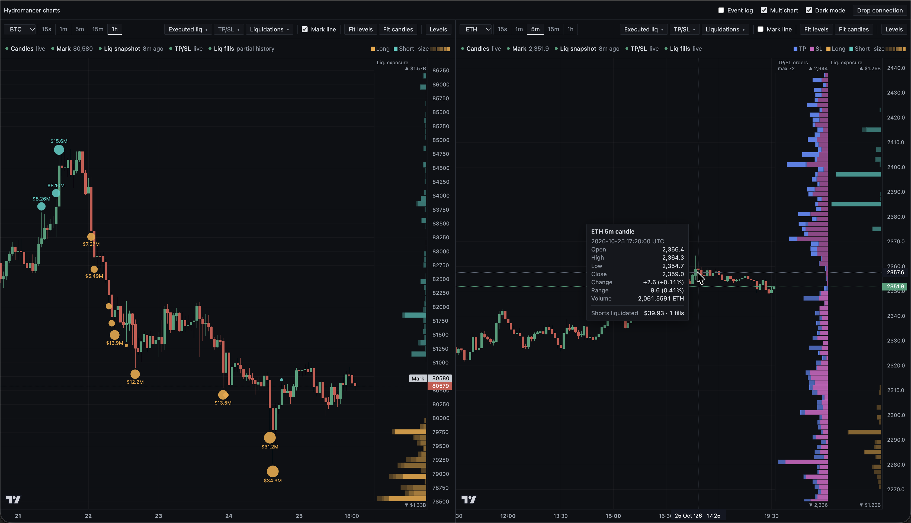
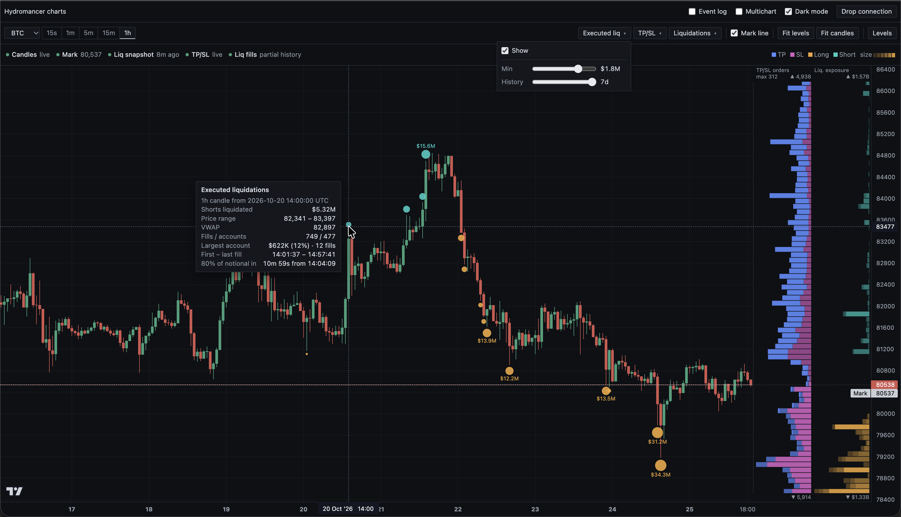
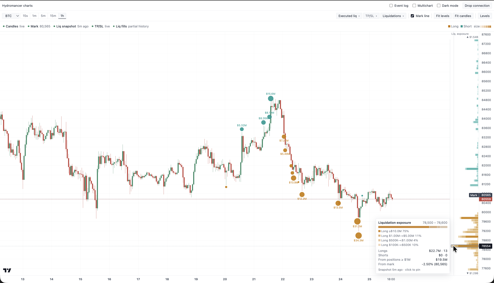
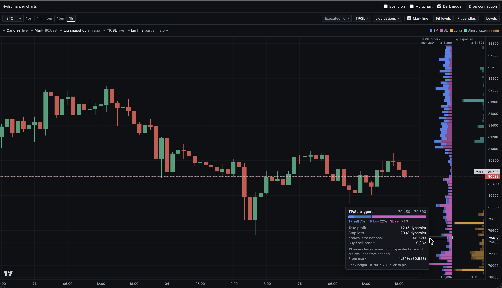
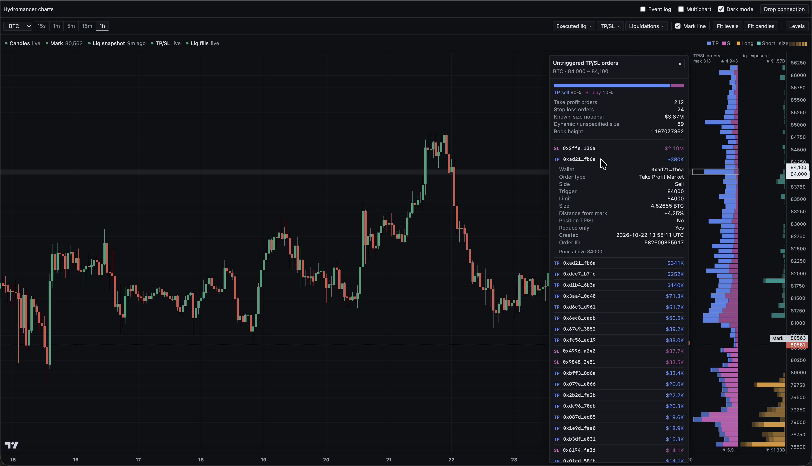

# Hydromancer charts

Embeddable Hyperliquid candlestick charts with 2 optional current-state price profiles:

### 1. Liquidation exposure: 
- estimated liquidation prices of currently open positions from Hydromancer's latest positioning snapshot. 
- Amber is long, teal is short. 
- Bar length is aggregated position notional, and opacity steps up through the $100K / $500K / $1M / $5M / $10M size bands.

### 2. TP/SL triggers: 
- the live, reconciled book of untriggered take-profit and stop-loss orders by trigger price. 
- Blue is take profit, magenta is stop loss, and buy orders are a darker shade of each. 
- Bar length is order count by default, so whole-position orders with no reported size are still counted.

## The library:

- wraps [Lightweight Charts](https://www.tradingview.com/lightweight-charts/) behind a small framework-agnostic API (`createChart`)
- uses Hydromancer's[https://hydromancer.xyz/] WebSocket & REST APIs for a better, faster data provider.


## Showcase

Two markets sharing one client, with independent chart settings.



| Executed liquidations | Liquidation exposure in light mode |
|---|---|
|  |  |

| TP/SL hover breakdown | Wallet and order inspection |
|---|---|
|  |  |

## Quick start

```bash
cp .env.example  .env        # then set your HYDROMANCER_API_KEY in the new .env file
npm i
npm run dev
```

Open http://localhost:5173.

## Usage:

```ts
import { createChart, createHydromancerClient } from "hydromancer-charts";

// One client, multiple charts share its socket, snapshots and orderbooks.
const client = createHydromancerClient();

// Chart init
const chart = createChart(document.getElementById("chart")!, {
    data: client,
    coin: "BTC",
    interval: "15m",
    theme: "dark",
    layers: { liquidations: { minPositionNotional: 1000000 } },
    chart: { timeScale: { secondsVisible: true } } // Lightweight-Charts options
});

// (Optional)
chart.subscribe((event) => {
    if (event.type === "selection") {
        console.log(event.selection); // underlying positions or orders
    }
});

// methods to control chart after init:
await chart.setMarket("ETH");
chart.applyOptions({ theme: "light", layers: { tpsl: { metric: "knownNotional" } } });

// Cleanup:
chart.destroy();
client.destroy();
```

## API

`createHydromancerClient()` and `createChart(element, options)` are factory functions called directly.
Call chart methods on the returned `chart` handle, and client methods on the shared `client` instance.

| Method | Behavior |
|---|---|
| `createChart(element,options)` | Returns a handle synchronously and starts loading. |
| `chart.setMarket(coin)` | Switches market. Resolves once candles are usable; overlays fill in with their own status. Rejects with `superseded` if another switch follows, or `disposed` after `chart.destroy()`. |
| `chart.setInterval(interval)` | Replaces only the candle feed (`15s`, `1m`, `5m`, `15m`, `1h`). Positions, the TP/SL book and the selection are kept. |
| `chart.applyOptions(patch)` | Theme, layers, palette, chart/candle options, gutter width, status bar and Levels button. Never reconnects feeds. |
| `chart.fitContent()` | Returns to the default candle width at the latest candle, with candle autoscale. |
| `chart.fitLevels()` | Scrolls to the latest candle and widens the price scale around mark to cover most nearby liquidation exposure. |
| `chart.scrollToLatest()` | Returns to the live edge and keeps the profile gutter. Double-clicking the chart does the same. |
| `chart.toggleLevels(open?)` | Opens or closes the level list, for hosts with their own Levels button (`showLevelsButton: false`). |
| `chart.select(selection)` | Selects a level programmatically (for example, from an event), or clears with `null`. |
| `chart.getState()` | Coin, interval, per-dataset status, mark, selection and options. |
| `chart.subscribe(listener)` | Typed `status`, `selection` and `error` events. Returns an unsubscribe function. |
| `chart.destroy()` | Idempotent. Releases only this chart's resources. |
